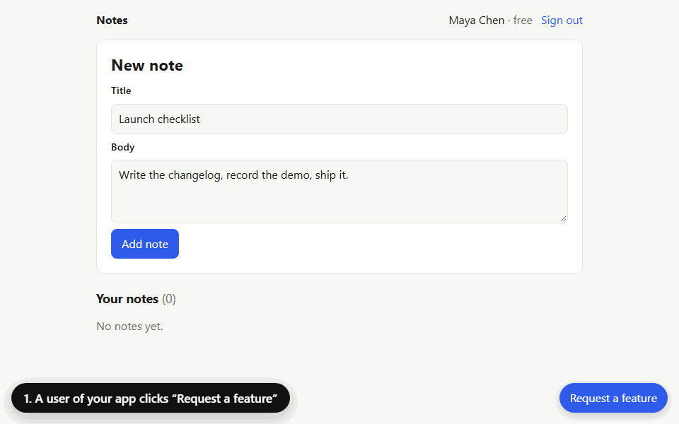

# totalmod

**Your users ask for a feature. An AI builds it. You merge.**



<sub>Recorded from [`examples/demo-notes`](examples/demo-notes). The Claude and GitHub calls are stubbed for the recording; the widget, server, preview link and mock-data preview are the real ones.</sub>

totalmod is a loop kit for Next.js SaaS apps:

1. A user clicks **Request a feature**.
2. An AI interviews them and writes a spec they confirm.
3. A GitHub Action has Claude Code build it on a branch.
4. The requester tries it on a private preview with **mock data** and asks for fixes.
5. **You** merge. Only then does it run on real data, behind a flag that turns on for that user first.

> Status: v0.2, early. **[Try the demo](https://demo.totalmod.dev)** · **[Install in 5 minutes](#quickstart-3-minutes)**

## Quickstart (3 minutes)

In a Next.js App Router app:

```bash
npx totalmod init
npm install @totalmod/server @totalmod/widget @totalmod/flags
```

`init` adds a route handler (`app/api/totalmod/[...totalmod]/route.ts`), an adapter (`lib/totalmod.ts`), a widget component, `totalmod.config.yaml`, a flags file, `seed/mock.ts` and two GitHub workflows. Then:

1. **Who is asking:** return the signed-in user from `getRequester` in `lib/totalmod.ts`, and render `<TotalmodWidget />` in your root layout.
2. **App env (production):** `ANTHROPIC_API_KEY`, `TOTALMOD_GITHUB_REPO`, `TOTALMOD_GITHUB_TOKEN`, `TOTALMOD_PREVIEW_SECRET`, `TOTALMOD_WEBHOOK_SECRET`.
3. **GitHub:** set the Actions secrets `ANTHROPIC_API_KEY` and `TOTALMOD_GITHUB_TOKEN`, and the variable `TOTALMOD_TRUSTED_ACTORS`. Add a webhook to `/api/totalmod/webhooks/github` for _Pull requests_ and _Deployment statuses_.
4. **Vercel Preview env:** only `TOTALMOD_MODE=mock` and `TOTALMOD_PREVIEW_SECRET`. See [docs/vercel.md](docs/vercel.md).
5. **Check it:**

   ```bash
   npx totalmod doctor
   ```

Wrap new features in `await isRequestEnabled(user.id, reqId)` from `@totalmod/flags`; the build agent does this for you. Add `"@totalmod/flags"` and `"@openfeature/flagd-provider"` to `serverExternalPackages` in `next.config`, because the flag provider must not be bundled.

## Try it without an API key

The interviewer can run on [Ollama](https://ollama.com) or [LM Studio](https://lmstudio.ai), so you can try the request flow with a model you already have. Start your model server, then from a clone of this repo:

```bash
pnpm i
TOTALMOD_LLM=ollama TOTALMOD_MODEL=qwen3.8 pnpm local:up
```

Use `TOTALMOD_LLM=lmstudio` for LM Studio, with its server started. `TOTALMOD_MODEL` is a name from `ollama list` or `lms ls`. If your server isn't on its default port, set `TOTALMOD_LLM_URL`, such as `http://localhost:11434/v1`. Then open <http://127.0.0.1:3200>, sign in and click **Request a feature**.

What to expect:

- **Interviewer only.** The questions, spec and "fix this" rewrites come from your model. GitHub is still stubbed in the demo, and the build step still needs Claude Code and an `ANTHROPIC_API_KEY`.
- **For testing, not production.** The interviewer is what keeps raw user text away from the coding agent, and its evals are written for Claude. So totalmod only accepts a model on the same machine, and a deployed app can't reach one.
- **Slower, and the model must fit in memory.** A reply can take a minute or more, especially the first one while the model loads.

## How it works

| Step           | Where                                             | What happens                                                                                                                                          |
| -------------- | ------------------------------------------------- | ----------------------------------------------------------------------------------------------------------------------------------------------------- |
| Request → spec | Your app (`@totalmod/widget`, `@totalmod/server`) | Up to 4 questions, then a spec the user confirms or edits once. A GitHub issue gets the spec only.                                                    |
| Build          | GitHub Action                                     | A policy check, Claude Code on `totalmod/req-<id>`, then a path check, a test run and a draft PR with a risk summary.                                 |
| Preview        | Vercel preview                                    | The branch runs on mock data with no production credentials. Only the requester gets a signed, 24-hour link.                                          |
| Iterate        | Widget → PR                                       | "Fix this" becomes concrete spec changes on the PR (3 rounds at most).                                                                                |
| Release        | You                                               | Merge turns the flag on for the requester. Labels roll it out: `totalmod:rollout-25`, `totalmod:ga`, `totalmod:off`. After GA, a PR removes the flag. |

## Safety model

- **Mock data until release.** Preview deployments have no production env vars and no path to your database. The demo also throws if a preview so much as reads `DATABASE_URL`. Isolation comes from the infrastructure, not a code branch.
- **The user's words never reach the coding agent.** Raw requests and "fix this" text stay in your database. Only the interviewer's confirmed spec, and its rewritten fix rounds, go to GitHub.
- **Policy lives in code and CI, not prompts.** Deterministic checks run before and after the model:
  - specs and fix rounds that touch auth, billing, migrations, admin, secrets or CI are declined;
  - the build fails closed on untrusted triggers, spent budgets or the iteration cap;
  - a path check rejects changes outside `totalmod.config.yaml`'s allowed paths, or over the line cap, before anything is pushed.
- **No secrets in agent context.** The agent gets `ANTHROPIC_API_KEY` and a scoped GitHub token. It has no network tools and can't commit or push.
- **One human gate.** Nothing reaches production data until you merge, and `totalmod:off` switches a feature off for everyone.

## Telemetry

totalmod sends **anonymous counts** so we know whether the loop works for people. On first run, the CLI says so.

| Event                | Sent by | Numbers attached |
| -------------------- | ------- | ---------------- |
| `first_run`          | CLI     | none             |
| `request_submitted`  | server  | questions asked  |
| `preview_ready`      | server  | fix round        |
| `iteration`          | server  | fix round        |
| `merged`, `rejected` | server  | fix rounds used  |
| `ga`                 | server  | none             |

Each event also carries an install id, the source (`cli` or `server`) and the version. The CLI's install id is random. The server's is an HMAC of the repo name keyed with your own `TOTALMOD_PREVIEW_SECRET`, so nobody can trace it back. **Never sent:** request text, specs, code, prompts, file paths, user ids, IP-derived data.

**Turn it off** with `DO_NOT_TRACK=1`, or `telemetry: false` in `totalmod.config.yaml`. Send it elsewhere with `telemetryEndpoint` (or `TOTALMOD_TELEMETRY_ENDPOINT`). The receiver is [`infra/telemetry-worker`](infra/telemetry-worker), a small Cloudflare Worker that validates events strictly and stores no IPs.

## "Built by a user" badge

Shipped something a user asked for? Say so in your changelog:

```md

```

The badge endpoint counts views, and nothing else.

## Packages

| Package                                     | What                                                                   |
| ------------------------------------------- | ---------------------------------------------------------------------- |
| [`totalmod`](packages/cli)                  | CLI: `init`, `doctor`                                                  |
| [`@totalmod/widget`](packages/widget)       | React "Request a feature" widget                                       |
| [`@totalmod/server`](packages/server)       | Route handlers: interview, issues, webhooks, preview links, fix rounds |
| [`@totalmod/flags`](packages/flags)         | `isRequestEnabled` on OpenFeature + flagd, and flags-file edits        |
| [`@totalmod/core`](packages/core)           | Schemas, config, policy checks, preview tokens                         |
| [`@totalmod/telemetry`](packages/telemetry) | The anonymous counts above                                             |
| [`action/`](action)                         | GitHub Actions: build (policy → Claude Code → path check) and release  |

[AGENTS.md](AGENTS.md) has the contributor rules and commands.

## License

totalmod is dual-licensed:

- **[AGPL-3.0](LICENSE)**: free, including for commercial use, if you share your application's source under the AGPL.
- **Commercial license**: for closed-source products and services. See [COMMERCIAL-LICENSE.md](COMMERCIAL-LICENSE.md).

Files that `npx totalmod init` adds to your repository are [MIT-0](templates/LICENSE): they're yours. Contributions need a signed [CLA](CLA.md); see [CONTRIBUTING.md](CONTRIBUTING.md).

Copyright © 2026 sumanprime.
